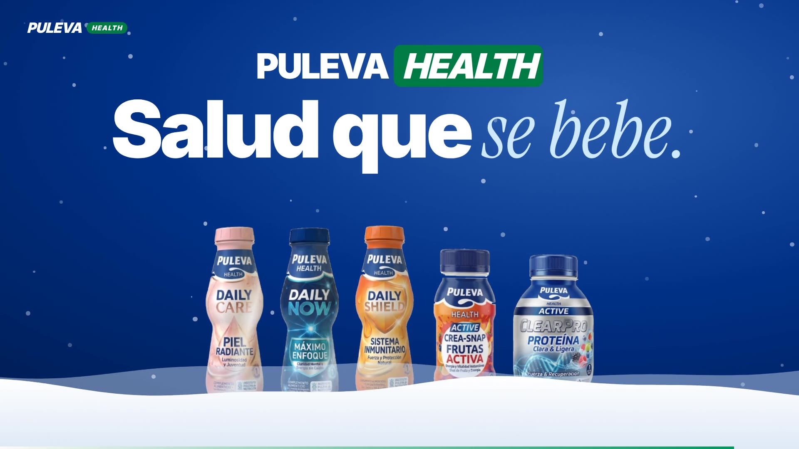

# Puleva Health · Salud que se bebe

**[🌐 Ver la web →](https://ismael-sallami.github.io/puleva-health/)** &nbsp;·&nbsp; **[📄 Descargar el informe (PDF)](https://ismael-sallami.github.io/puleva-health/media/PulevaHealth_Grupo6.pdf)**

[](https://ismael-sallami.github.io/puleva-health/)

Propuesta del **Grupo 6** para el **Hackathon de Innovación UGR × Lactalis Puleva 2026 (4.ª edición)**. El reto era diseñar cómo podría entrar Lactalis Puleva en el mercado de los complementos nutricionales de hipermercados y supermercados.

La respuesta es **Puleva Health**: complementos naturales en **monodosis líquidas**, al estilo de un Actimel, organizados en dos líneas complementarias.

| Línea | Productos | Para qué |
| --- | --- | --- |
| **Daily** · salud y prevención | Care (piel), Now (concentración), Shield (defensas, con lactoferrina) | Cuidarse cada día, en la nevera de lácteos |
| **Active** · rendimiento | Crea-Snap (creatina en el tapón), ClearPro (proteína *clear*) | Deporte, sin bote ni báscula |

## Qué hay en la web

- **Botes en 3D** con Three.js: tienen volumen, brillo en la etiqueta y se recolocan al hacer scroll sobre una ola de leche animada.
- **Spot de 67 segundos** hecho con Remotion (React), con voz neuronal sintética, música generada por código y subtítulos sincronizados palabra a palabra.
- **"Un día con Puleva Health"**: un recorrido horizontal del desayuno al gimnasio, con el cielo cambiando de hora.
- La demo de **Crea-Snap**: por qué la creatina va en el tapón y no disuelta.
- Las cifras del business case, el go to market y la autoevaluación del reto.

## Ejecutarla en local

Es una web estática sin dependencias de compilación:

```bash
python3 -m http.server 8000
# y abre http://localhost:8000
```

## Equipo

David Bacas Posadas · Ismael Sallami Moreno · Jesús Rodríguez González
Doble Grado en Ingeniería Informática y ADE · Universidad de Granada · Dirección Estratégica I

---

> **Concepto académico.** No es una web oficial de Lactalis Puleva, ni está respaldada por la empresa: las marcas pertenecen a sus propietarios y los productos e imágenes son prototipos ficticios creados para el hackathon. La web no se indexa en buscadores.
>
> *Complemento alimenticio. No debe utilizarse como sustituto de una dieta equilibrada y un modo de vida sano.*
